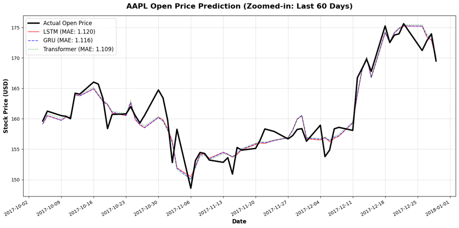
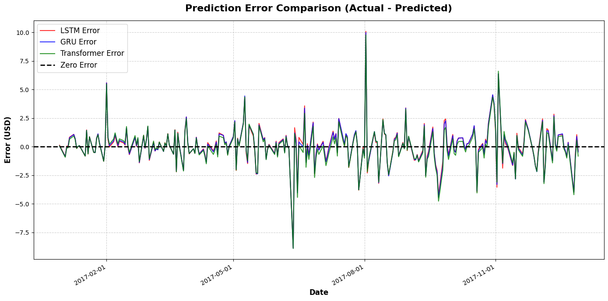

# 🍏 AAPL Stock Price Forecasting: LSTM, GRU & Transformer


## 📖 Project Overview
This project presents a comprehensive deep learning pipeline designed to forecast the next-day Open price of Apple (AAPL) stock. Moving beyond traditional raw price prediction, the target variable was engineered as **Log Returns** to eliminate the "lag" problem and capture true market momentum.

The primary objective was to rigorously compare three distinct neural network architectures: **LSTM**, **GRU**, and a custom **Transformer** with Positional Encoding, to determine the most effective and efficient model for financial time-series forecasting.

## ⚙️ Methodology & Pipeline
1. **Financial Feature Engineering:** Transformed raw prices into stationary Log Returns. This prevents neural networks from becoming "lazy" (simply predicting tomorrow's price equals today's price) and forces them to learn actual market patterns.
2. **Data Preparation:** Applied a chronological 80/20 train-test split to prevent Look-ahead Bias. Used a 30-day sliding window for sequences and `MinMaxScaler` fitted strictly on the training set to prevent data leakage.
3. **Architecture & Tuning:** 
   * Built LSTM and GRU sequential models.
   * Built a Transformer model with a **Custom Positional Encoding layer** (sine/cosine) to inject time-awareness into the self-attention mechanism.
   * Utilized **Keras Tuner (Hyperband)** to optimize layers, units, and learning rates for all three models.
4. **Price Reconstruction:** Reversed the log transformation (\(P_{pred} = P_{prev} \times e^{r_{pred}}\)) to evaluate models in real USD values.

## 🏆 Results
All three models successfully tracked the market trend, but the Transformer achieved the highest accuracy by leveraging Self-Attention.

| Model Architecture | MAE (USD) | Characteristics |
| :--- | :--- | :--- |
| LSTM | 1.1199 | Sequential Memory |
| GRU | 1.1165 | Efficient Sequential Memory |
| **Transformer (Winner)** | **1.1089** | **Self-Attention & Positional Encoding** |

## 💡 Key Insights
* **The "Noise Ceiling" of Finance:** While the Transformer outperformed the sequential models, the margin of improvement was less than 1.1 cents. This proves that all models have reached the theoretical predictability limit of the dataset, where errors are driven by unpredictable news and macroeconomic shocks, not historical patterns.
* **GRU vs. Transformer for Production:** Although the Transformer won by a tiny margin, the GRU is arguably the most practical choice for production deployment. It offers near-identical accuracy with a significantly lighter computational footprint and faster training time.
* **Responsive to Market Shifts:** During sudden price drops, the Transformer handled the volatility more responsively than sequential models. Self-attention allowed the model to selectively focus on the most relevant historical days rather than relying solely on the immediate previous state.

## 📊 Visualizations


 

## 📂 Repository Structure
```text
├── notebooks/
│   └── apple-stock-forecasting.ipynb    # Main Jupyter Notebook
├── requirements.txt                     # Python dependencies
└── README.md                            # Project documentation

```
## 🚀 How to Run

1. Clone the repository:
   git clone https://github.com/AliPakzad/AAPL-Stock-Price-Forecasting.git

2. Install the required packages:
   pip install -r requirements.txt

3. Open the Jupyter Notebook and run the cells:
   jupyter notebook notebooks/apple-stock-forecasting.ipynb

## 🔗 Links
* **Kaggle Notebook:** https://www.kaggle.com/code/alipakzad/apple-stock-prediction-lstm-gru-transformer
* **LinkedIn:** https://www.linkedin.com/in/ali-pakzad-b145a3b4
* **GitHub Profile:** https://github.com/AliPakzad

---
**Author:** Ali Pakzad (Data Scientist & ML Engineer)
